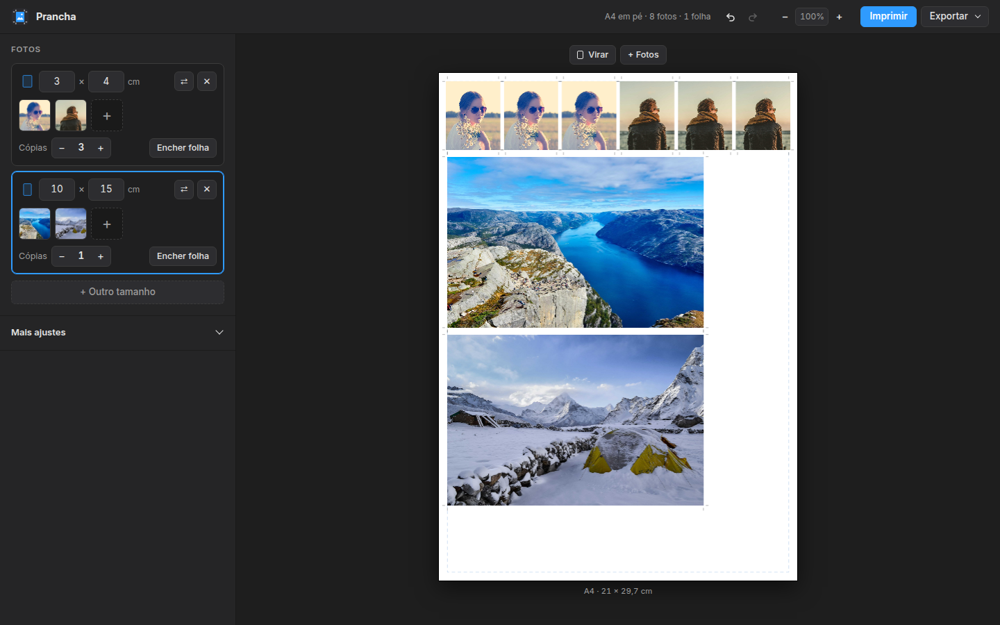
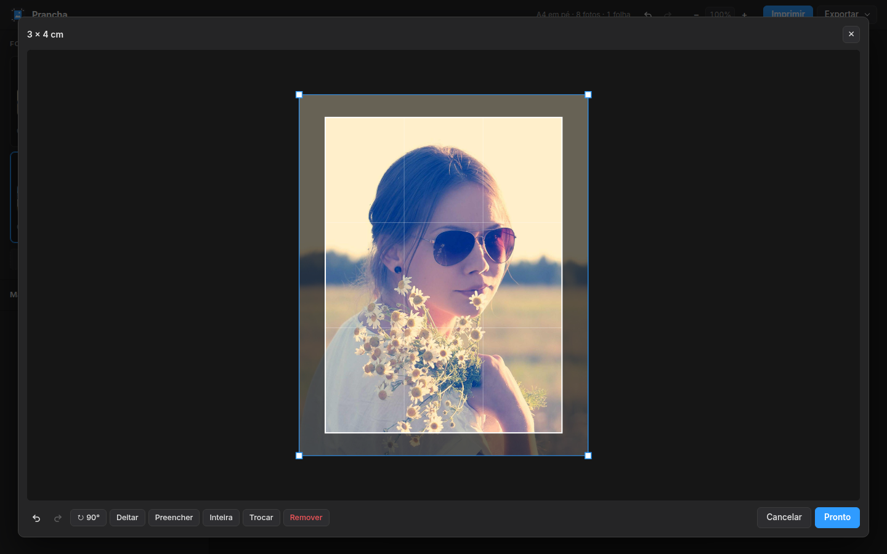
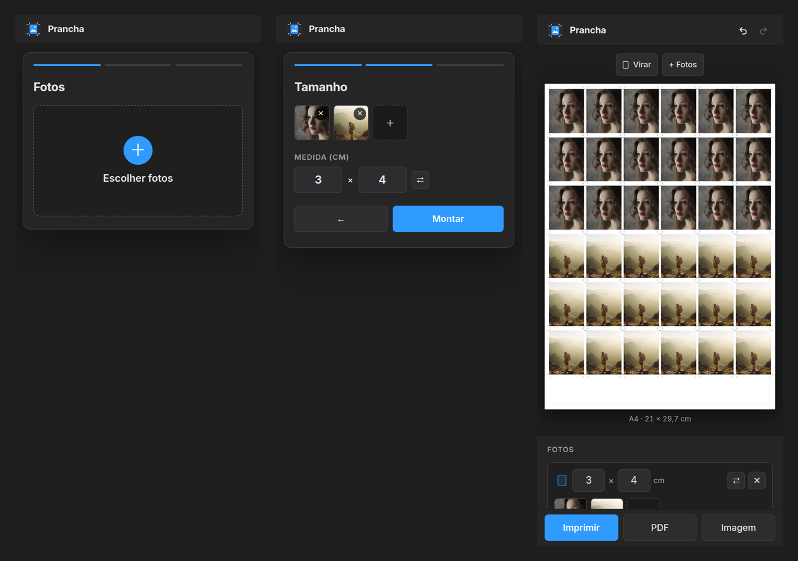

# Prancha

**Fotos na medida exata, prontas para recortar.**

Escolha as fotos e o tamanho, e a Prancha monta a folha com marcas de corte. É só imprimir e
recortar.

🌐 **[prancha.rodrigohub.com](https://prancha.rodrigohub.com)**



## Recursos

- Vários tamanhos na mesma folha, com cópias e "encher a folha"
- Recorte com alças: redimensionar, mover e girar livre
- Marcas de corte e sangria de 1 mm
- A4, A5, A3, Carta, 10 × 15 ou medida própria
- Imprimir, PDF ou PNG em 300 dpi
- As fotos não saem do seu aparelho





> Na impressora, escolha **tamanho real (100%)**.

## Atalhos

| | |
|---|---|
| `Ctrl` `Z` / `Ctrl` `Shift` `Z` | desfazer / refazer |
| `Ctrl` `P` | imprimir |
| `Shift` ao girar | gira de 15 em 15 graus |
| `Enter` / `Esc` no editor | aplicar / cancelar |

## Rodar local

```bash
python3 -m http.server 8000
```
